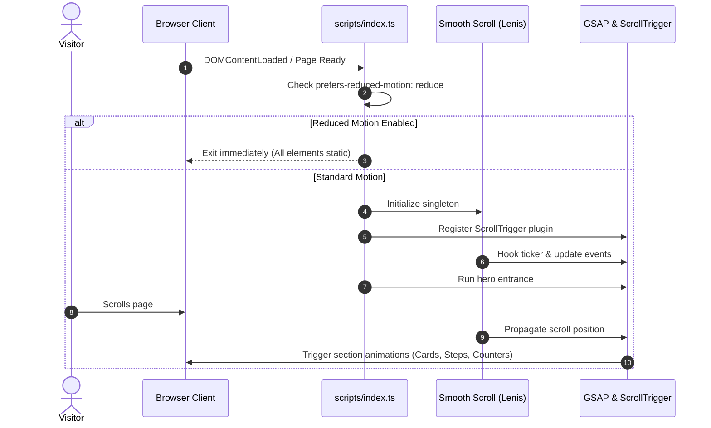

# Design: Page Animations & Motion Orchestration (Phase 4)

## Architectural Approach

Phase 4 introduces modular client-side motion orchestration using GSAP 3 (ScrollTrigger) and Lenis smooth scrolling. The architecture strictly adheres to the progressive enhancement and performance rules in `SPEC.md` and `AGENTS.md`:
1. **Zero LCP/CLS Regression**: Hero elements remain visible immediately; no layout-triggering properties (`top`, `left`, `width`, `height`) are animated.
2. **Progressive Enhancement**: Content is 100% visible and styled in static HTML/CSS. Initial animation states are applied exclusively by JavaScript. If JS fails or is disabled, the page renders identically to Phase 3.
3. **Master Timeline Coordination**: Adjacent sections overlap by 20–30% during scroll progression to eliminate abrupt pop-ins and create continuous narrative flow.
4. **Reduced Motion First-Class Citizen**: When `prefers-reduced-motion: reduce` is detected, Lenis and all GSAP scroll triggers are completely bypassed.

```
                            ┌────────────────────────┐
                            │    src/scripts/        │
                            │      index.ts          │
                            └───────────┬────────────┘
                                        │
                 ┌──────────────────────┴──────────────────────┐
                 │ prefers-reduced-motion: reduce?             │
                 ├────────────────────────┬────────────────────┤
                 │ YES                    │ NO                 │
                 ▼                        ▼                    ▼
        ┌──────────────────┐    ┌──────────────────┐  ┌──────────────────┐
        │ Bypass motion    │    │ smooth-scroll.ts │  │ master-timeline  │
        │ Static rest state│    │ (Lenis + GSAP)   │  │ (ScrollTrigger)  │
        └──────────────────┘    └─────────┬────────┘  └────────┬─────────┘
                                          │                    │
                                          └──────────┬─────────┘
                                                     ▼
                             ┌───────────────────────────────────┐
                             │ Section Animation Modules         │
                             │  - hero.ts (LCP-safe reveal)      │
                             │  - services.ts (Card stagger)     │
                             │  - process.ts (Wire harness/steps)│
                             │  - trust.ts (Counter tweens)      │
                             │  - faq.ts (Accordion physics)     │
                             └───────────────────────────────────┘
```

## Architecture Decisions

| Decision | Choice | Alternatives Considered | Rationale |
|---|---|---|---|
| **Smooth Scroll Engine** | Lenis singleton synchronized via GSAP ticker | Native CSS `scroll-behavior: smooth` | Provides normalized cross-browser momentum scroll without breaking ScrollTrigger pin/scrub calculations. |
| **Animation Properties** | Only `transform` and `opacity` | Element dimension/position animations | Avoids browser layout recalcs and reflows; executed directly on the GPU compositor thread. |
| **Progressive Disclosure** | `gsap.from()` runtime tweens | Static CSS classes like `.opacity-0` | Guarantees that users without JavaScript or on slow connections never see empty/blank sections. |
| **Numeric Counters** | GSAP tweening a virtual proxy object updating `textContent` | Third-party counter libraries (`countUp.js`) | Zero additional npm dependencies; leverages the already-loaded GSAP core engine. |
| **Wire Harness Motif** | Responsive SVG with bezier curves and dynamic stroke-dashoffset / path morphing | 3D Canvas / WebGL | Ultra-lightweight (few KB), sharp on all DPR displays, perfectly matches neo-brutalist 2D line styling. |

## Detailed Module Specifications

### 1. Smooth Scroll Bridge (`src/scripts/smooth-scroll.ts`)
- Creates a singleton `Lenis` instance:
  ```ts
  import Lenis from 'lenis';
  import gsap from 'gsap';
  import { ScrollTrigger } from 'gsap/ScrollTrigger';

  export function initSmoothScroll(): Lenis | null {
    if (window.matchMedia('(prefers-reduced-motion: reduce)').matches) {
      return null;
    }

    const lenis = new Lenis({
      duration: 1.0,
      easing: (t) => Math.min(1, 1.001 - Math.pow(2, -10 * t)),
      orientation: 'vertical',
      smoothWheel: true,
    });

    lenis.on('scroll', ScrollTrigger.update);
    gsap.ticker.add((time) => {
      lenis.raf(time * 1000);
    });
    gsap.ticker.lagSmoothing(0);

    return lenis;
  }
  ```

### 2. Section Animation Modules (`src/scripts/animations/`)

#### `hero.ts`
- Subtle staggered reveal on client load:
  - Sticker badge: `y: -15, opacity: 0` -> rest
  - Subtitle & buttons: `y: 20, opacity: 0` -> rest
  - Hero `h1` maintains immediate DOM presence to safeguard LCP.

#### `services.ts`
- Triggered at `top 80%` of `#servicios`:
  - Staggered entrance for the 4 service cards (`stagger: 0.12s`, `y: 40`, `opacity: 0`).
  - Marquee strip: acceleration effect on scroll velocity via ScrollTrigger scrub.

#### `process.ts`
- Sequential step illumination:
  - Steps 01 to 05 reveal progressively (`stagger: 0.15s`, `x: -20`, `opacity: 0`).
  - Connecting horizontal wire harness line grows across steps using `scaleX: 0 -> 1`.

#### `trust.ts`
- Numeric counter animations for metrics (`95+`, `100%`, `0`):
  - Elements with `data-counter="95"` animate from 0 to target value when entering viewport.
  - Final target text remains strictly preserved if interrupted.

#### `faq.ts`
- Micro-interactions for `<details>` elements when opened/closed.

### 3. Master Timeline Orchestrator (`src/scripts/animations/master-timeline.ts`)
- Chains the section triggers:
  ```ts
  // Adjacent sections overlap by ~25%
  // Section A start: "top 80%", Section B start: "top 80%" (already starts preparing while A is in view)
  ```

### 4. Component Hooks & HTML Attributes
- Non-destructive `data-animate` attributes added to section templates:
  - `data-animate-hero`
  - `data-animate-card`
  - `data-animate-step`
  - `data-counter="95"` `data-counter-suffix="+"`
  - `data-counter="100"` `data-counter-suffix="%"`



## Testing Strategy (`tests/animations.spec.ts`)

| Test Suite | Assertions | Viewports |
|---|---|---|
| **Progressive Enhancement (No JS)** | With `javaScriptEnabled: false`, all sections, cards, and text in Home & Services are visible (`opacity > 0.9`, attached, non-zero bounding box). | Desktop & Mobile |
| **Reduced Motion Fallback** | With `reducedMotion: 'reduce'`, all counters display their final target strings immediately and no Lenis wrapper classes interfere. | Desktop & Mobile |
| **Metric Counters Completion** | Counters in `#confianza` reach their destination values (`95+`, `100%`) when scrolled into view. | Desktop |
| **Layout Stability & Zero CLS** | No horizontal overflow across 360px and 1280px viewports while animations fire. | Desktop & Mobile |

## File Modifications Summary

| File | Status | Description |
|---|---|---|
| `src/scripts/smooth-scroll.ts` | Create | Lenis initialization and GSAP ticker sync |
| `src/scripts/animations/hero.ts` | Create | LCP-safe hero reveal |
| `src/scripts/animations/services.ts` | Create | Services card stagger & marquee velocity |
| `src/scripts/animations/process.ts` | Create | Process steps stagger & wire harness indicator |
| `src/scripts/animations/trust.ts` | Create | Counter tween engine |
| `src/scripts/animations/master-timeline.ts` | Create | Interlaced page timeline coordinator |
| `src/scripts/index.ts` | Create | Main client bootstrap entrypoint |
| `src/layouts/Base.astro` | Update | Import client script `/src/scripts/index.ts` |
| `src/components/sections/Trust.astro` | Update | Add `data-counter` targets |
| `src/components/sections/Process.astro` | Update | Add process animation hooks |
| `src/components/sections/ServicesSection.astro` | Update | Add services animation hooks |
| `tests/animations.spec.ts` | Create | Playwright verification suite for motion & accessibility |
