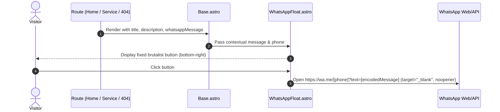

# Design: Transversal Features & Technical SEO Assets (Phase 3)

## Architectural Approach

Phase 3 establishes the cross-cutting functionalities and technical SEO assets mandated by `SPEC.md` Section 7 and the Phase 3 roadmap. The design unifies transversal elements (floating WhatsApp contact trigger, 404 error page, multi-variant favicon suite, Open Graph cards, and JSON-LD structured data) directly into `src/layouts/Base.astro` and standardizes their behavior across all static routes.

```
                      ┌────────────────────────────────────────┐
                      │          src/layouts/Base.astro        │
                      └───────────────────┬────────────────────┘
                                          │
            ┌─────────────────────────────┼────────────────────────────┐
            ▼                             ▼                            ▼
   ┌─────────────────┐           ┌─────────────────┐          ┌─────────────────┐
   │ <head> Metadata │           │ Body Content    │          │ Global UI       │
   │ - Full Favicons │           │ - Semantic HTML │          │ - Skip Link     │
   │ - OG 1200x630   │           │ - Page Slots    │          │ - WhatsAppFloat │
   │ - Twitter Cards │           │   (header/main) │          │   (contextual)  │
   │ - JsonLd (safe) │           └─────────────────┘          └─────────────────┘
   └─────────────────┘
            │
            ▼
   ┌────────────────────────────────────────────────────────────────────────────┐
   │ Routes: Home (/) | Services (/servicios/[slug]) | Error (/404)             │
   └────────────────────────────────────────────────────────────────────────────┘
```

## Architecture Decisions

| Decision | Choice | Alternatives Considered | Rationale |
|---|---|---|---|
| **WhatsApp Float Centralization** | Integrated directly via `Base.astro` with page-level `whatsappMessage` override | Manual import & component mounting per page | Eliminates route drift; guarantees every current and future page (`/`, `/servicios/*`, `/404`) automatically features the floating contact action. |
| **Favicon Asset Generation** | High-resolution programmatic generation via Python Pillow (`PIL`) for build-time generation | Manual image editor export, external npm dependencies (`sharp`/`resvg`) | Fully reproducible, zero npm bloat, creates clean pixel-perfect neo-brutalist PNGs (32x32, 192x192, 512x512, 180x180) from brand vectors. |
| **Open Graph Card** | Branded static 1200x630 PNG (`public/og-image.png`) with neo-brutalist typography and offset borders | Dynamic runtime OG generator (`@astrojs/vercel/og`, Satori) | Eliminates runtime SSR dependencies, guarantees instant edge delivery, zero latency, and zero build failures. |
| **URL Resolution in Structured Data** | Standard `new URL(path, siteUrl).href` constructor | String template literals (`${siteUrl}${path}`) | Prevents edge-case missing/double slash bugs when `siteUrl` is provided without trailing slash. |
| **Test Runner Server Isolation** | Configure Playwright test web server on dedicated port (4322) with `reuseExistingServer: false` | Port 4321 with `reuseExistingServer: true` | Prevents tests from connecting to active local `astro dev` instances that inject the Astro Dev Toolbar (which injects extra shadow H1 elements). |

## Component & Asset Specifications

### 1. Global Floating WhatsApp (`src/components/ui/WhatsAppFloat.astro`)
- **Visual Presentation**:
  - Neo-brutalist styling: `border-brutal shadow-brutal bg-orange text-black font-extrabold uppercase`.
  - Accessible tap target: Minimum 48×48 px (`px-4 py-3 sm:px-5 sm:py-3.5`).
  - Positioning: `fixed bottom-4 right-4 sm:bottom-6 sm:right-6 z-50 pointer-events-auto`.
  - Interaction: Neo-brutalist hover displacement (`hover:translate-x-0.5 hover:translate-y-0.5`).
- **Contextual Messaging**:
  - Default route message: `"Hola Harness Studio, me interesa consultar por un proyecto."`
  - Service pages: Configured via Markdown frontmatter (`whatsappMensaje`).
  - 404 error page: `"Hola Harness Studio, me perdí en la web y necesito ayuda."`
  - URL encoding: Always wrapped in `encodeURIComponent()`.



### 2. Branded 404 Error Page (`src/pages/404.astro`)
- **Structure & Semantics**:
  - Top landmark: `<Nav slot="header" />`
  - Main section: `<section class="min-h-[70vh] flex flex-col items-center justify-center px-4 py-24 text-center max-w-4xl mx-auto">`
  - Badge: `<Badge variant="orange" rotate={-2}>Error 404</Badge>`
  - Single `<h1>`: `Página no encontrada` (`font-display text-4xl sm:text-6xl font-black uppercase text-black leading-none mb-6`)
  - Subtitle: `La dirección a la que intentás ingresar no existe o fue modificada.`
  - Action buttons:
    - Primary Button: `Volver a la Home ➔` (`href="/"`)
    - Secondary Button: `Ver Servicios` (`href="/#servicios"`)
  - Bottom landmark: `<Footer slot="footer" />`
- **Sitemap Exclusion**:
  - Omitted from `dist/sitemap-index.xml` via `@astrojs/sitemap` configuration.

### 3. Favicon Asset Suite (`public/`)
| File | Dimensions | Purpose |
|---|---|---|
| `favicon.svg` | Scalable | Modern vector-capable desktop browsers |
| `favicon-32x32.png` | 32×32 px | Standard desktop browser tab favicon |
| `favicon-192x192.png` | 192×192 px | Android Chrome / Web App manifest |
| `favicon-512x512.png` | 512×512 px | Android high-res / splash screen |
| `apple-touch-icon.png` | 180×180 px | iOS Home screen bookmark icon |

Declarations in `src/layouts/Base.astro`:
```html
<link rel="icon" type="image/svg+xml" href="/favicon.svg" />
<link rel="icon" type="image/png" sizes="32x32" href="/favicon-32x32.png" />
<link rel="icon" type="image/png" sizes="192x192" href="/favicon-192x192.png" />
<link rel="icon" type="image/png" sizes="512x512" href="/favicon-512x512.png" />
<link rel="apple-touch-icon" sizes="180x180" href="/apple-touch-icon.png" />
```

### 4. Open Graph Preview Asset (`public/og-image.png`)
- **Dimensions**: 1200×630 px.
- **Neo-Brutalist Layout**:
  - Background: Black (`#0A0A0A`) with inner white brutalist border (`#FFFFFF`, 8px).
  - Accent block: Orange container (`#FF5A00`) with hard offset black shadow (`12px 12px 0 #000000`).
  - Title: Large uppercase `HARNESS STUDIO` display typography.
  - Subtitle: `Desarrollo Web & Software a Medida`.
  - Service tags: `Landing Pages` | `Tienda Nube` | `E-commerce` | `Software`.
- **Metadata tags in `Base.astro`**:
  - `og:image`: Absolute canonical URL (`new URL(ogImage, siteUrl).href`)
  - `og:image:width`: `1200`
  - `og:image:height`: `630`
  - `twitter:image`: Absolute canonical URL
  - `twitter:card`: `summary_large_image`

### 5. Structured Data Hardening (`src/components/seo/JsonLd.astro`)
- Safe URL resolution:
  ```ts
  const siteUrl = Astro.site ? Astro.site.href : 'https://harness.studio';
  const logoUrl = new URL('/favicon.svg', siteUrl).href;
  ```
- Guaranteed schemas:
  - `Organization`: Global on all routes with name, url, logo, and contactPoint.
  - `Service`: On `/servicios/[slug]` with offers catalog.
  - `BreadcrumbList`: On `/servicios/[slug]` linking Home > Servicios > [Service].
  - `FAQPage`: On Home and service pages when FAQ items are supplied.

## Automated Testing Strategy (`tests/features.spec.ts`)

| Test Suite | Assertions | Viewports |
|---|---|---|
| **WhatsApp Float Visibility & Context** | - Fixed bottom-right positioning without layout shift<br>- `aria-label="Contactar por WhatsApp"`<br>- `target="_blank"` & `rel="noopener noreferrer"`<br>- Verified query parameters on `/`, `/servicios/landing-pages`, and `/404` | Desktop (1280px)<br>Mobile (360px) |
| **404 Page Behavior** | - Single `<h1>` with exact copy<br>- Working navigation buttons to `/` and `/#servicios`<br>- Absence from `sitemap-index.xml`<br>- Contextual WhatsApp float present | Desktop & Mobile |
| **Favicon Head Tags & Asset Delivery** | - All 5 `<link rel="*icon*">` tags present in `<head>`<br>- Assets return HTTP 200 and exist on disk | Desktop |
| **Social Metadata & OG Image** | - `og:image` and `twitter:image` tags use absolute URLs<br>- `og-image.png` exists in `public/` and `dist/` | Desktop |
| **Structured Data Robustness** | - `script[type="application/ld+json"]` elements parse as valid JSON<br>- `Organization` logo is absolute URL<br>- Zero malformed URL concatenations | Desktop |

## File Modifications Summary

| File | Status | Description |
|---|---|---|
| `public/favicon-32x32.png` | Create | Standard 32px tab favicon |
| `public/favicon-192x192.png` | Create | 192px Android/PWA favicon |
| `public/favicon-512x512.png` | Create | 512px high-res favicon |
| `public/apple-touch-icon.png` | Create | 180px iOS icon |
| `public/og-image.png` | Create | 1200x630 branded social share card |
| `scripts/generate-assets.py` | Create | Python script to generate all raster assets from brand specifications |
| `src/layouts/Base.astro` | Update | Inject full favicon link set, OG metadata dimensions, and centralize `<WhatsAppFloat>` |
| `src/components/ui/WhatsAppFloat.astro` | Update | Standardize responsive bottom/right spacing and mobile touch target |
| `src/pages/404.astro` | Update | Pass contextual WhatsApp message to layout and verify single H1 |
| `src/pages/index.astro` | Update | Remove duplicate manual `<WhatsAppFloat>` instantiation |
| `src/pages/servicios/[slug].astro` | Update | Pass `whatsappMessage={data.whatsappMensaje}` to `Base` layout |
| `src/components/seo/JsonLd.astro` | Update | Secure logo and entity URL concatenation |
| `playwright.config.ts` | Update | Set dedicated test port and prevent collisions with running dev servers |
| `tests/features.spec.ts` | Create | End-to-end verification suite for all Phase 3 deliverables |
